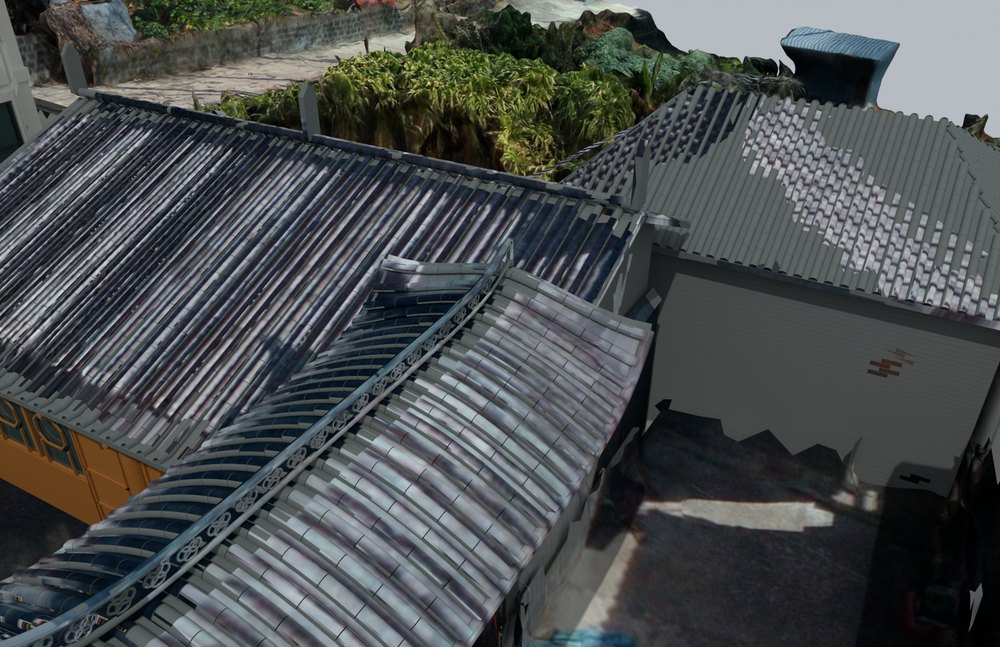
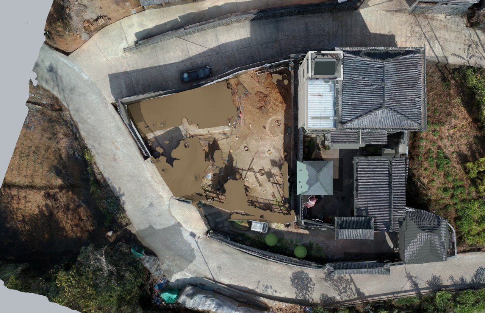

# V8 · 西侧清场、楼梯镜像及门和房间登记

[逐版目录](README.md) · [建筑重建台账](../../reconstruction.md) · [阶段方法汇总](../v01-v23.md) · [上一篇 V7](v7.md) · [下一篇 V9](v9.md)

## 摘要

修整飞檐、木构屋面交接、院墙、罗马柱弧梁和楼梯，清理指定西侧棚屋区。另存门与房间交互登记。

## 1. 问题与输入

从 V7 场地和建筑补块继续，分别处理指定棚屋区域、楼梯行进方向和门叶运动。清场边界和房间连接需要各自的核验依据。

## 2. 实现方法

1. 先画指定西侧清理区，再以该范围裁切被清理的棚屋和附属构件，按已有地形恢复连续表面。飞檐、弧梁柱头和厨门交接各取局部轮廓。
2. 对两层楼梯梯跑按楼梯井与右侧实墙镜像，联动内侧斜扶手，保留中间平台。用同层门墙关系恢复一层右卫前墙门位、关闭侧门洞。
3. 导出门与房间登记，稳定标识用于串接固定框、活动件与连通区域。模型另存融合、原生实体和 LOCAL 交换文件。

## 3. 过程图

*图 1 · 木构厨房和门楼交接。过程文件 `Rebuild_V8_Hybrid/06_Report/V8_Kitchen_Gate_Joint.png`。*

*图 2 · V8 清理指定西侧棚屋范围后的地形。过程文件 `Rebuild_V8_Hybrid/06_Report/V8_West_Terrain_Only.png`。*

## 4. 验证与适用范围

登记含 15 个门记录，其中 13 个平开门铰轴和 2 片推拉门，覆盖 19 个房间或区域。融合和编辑模型的原生回读分别检查对象有效性，登记可用于后续交互绑定。

| 过程报告 | 原报告读数 |
| --- | --- |
| `Rebuild_V8_Hybrid/06_Report/Native_Hybrid_QA.json` | 无效对象记录 0，实景底网格 5。 |
| `Rebuild_V8_Hybrid/06_Report/Editable_Local_Native_QA.json` | 无效对象记录 0，核验容差（m） 0.001。 |

## 5. 复现入口与出处

过程路径以本地 `JIA` 项目为根，`work/` 指重建项目的历史工作目录。复核时按交付记录打开本轮输入与保存成果，再依方法中的截面、对象或动作采样对照原报告。

- **交付与参考记录**。`Rebuild_V8_Hybrid/使用说明.md`

- **原实现脚本**。`work/prepare_v8.py` · `work/build_v8_patch.py` · `work/export_v8_interaction_registry.py` · `work/prepare_v8_render.py` · `work/prepare_v8_pipeline.py`

过程图校验值

| 图 | 原过程图 SHA-256 | 发布方式 |
| --- | --- | --- |
| 1 | `a1a5d71fdb3c5a61a8ad4474dbd4695bcf6fbdd668a4ec75ff8599cc0c2c6a64` | 台账发布图，按原图缩放及压缩 |
| 2 | `d95782424f4d5e3da75ee623ed7d6e2ba9c9b7e8e955ad9b69048664aaf43456` | 保留原画面，发布用 JPEG |

