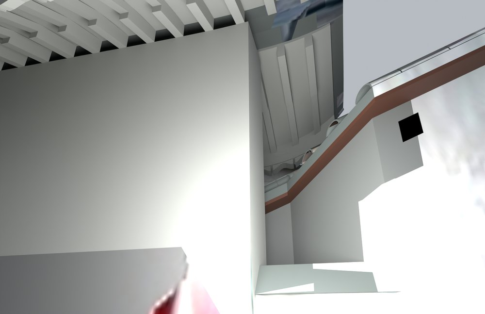
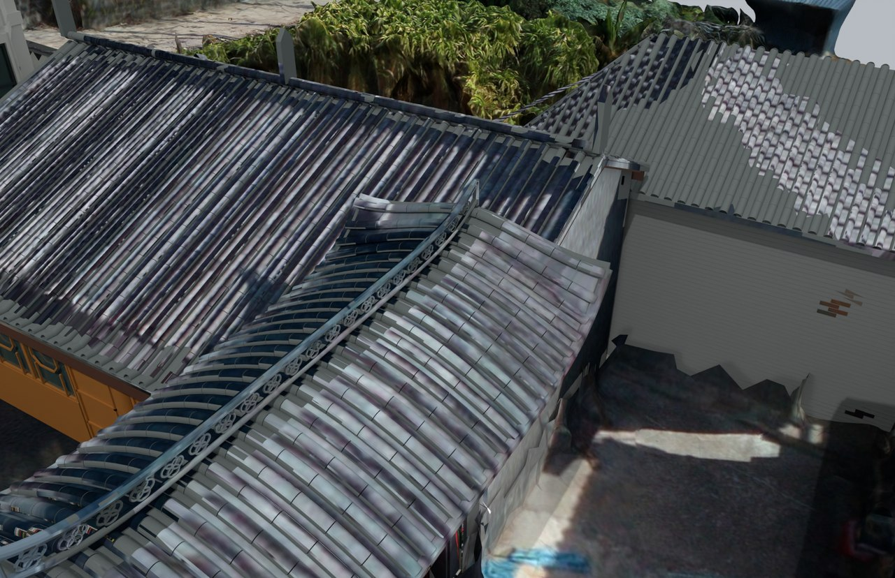

# V9 · 由高低檐覆盖关系修正门楼和厨房交接

[逐版目录](README.md) · [建筑重建台账](../../reconstruction.md) · [阶段方法汇总](../v01-v23.md)

## 摘要

厨房端部伸入较高门楼檐下，重做局部墙芯、封檐和檐下件。以当前保存的 V8 为基线，保留已确认的梁删除。

## 1. 问题与输入

以当前实际保存的 V8 和修改前快照为准，保留已经确认的三层梁删除。问题集中在厨房低檐是否真正伸入门楼高檐下，以及檐下是否留有缺口。

## 2. 实现方法

1. 用关系图判高檐、低檐和搭盖先后。门楼灰色封檐及檐下花板与厨房木构和金属收边按所属构件分开。

2. 在相交角部伸入厨房端部，封合墙芯、可见檐下和边口，沿用门楼及普通厨房坡面公式。

3. 在局部多边形内比较修前修后几何，独立检查已删除梁没有重新出现、非交接区域保持原先形状，以及原生文件闭合。

### 实现链与源码定位

以下按诊断、处理、保存与复核组织阅读。调用和文件引用来自原脚本，输入输出方向由对应读写调用判断；辅助文件是否在本轮运行，以报告为准。

**1. 定位与诊断** · [`final_v9_audit.py`](../source-code/v9/project/07_Evidence/v9_reference_audit/final_v9_audit.py#L34)

判据与回归检查 [`checks.append`](../source-code/v9/project/07_Evidence/v9_reference_audit/final_v9_audit.py#L18)；实体运算对象 [`md.Manifold`](../source-code/v9/project/07_Evidence/v9_reference_audit/final_v9_audit.py#L34)；交集限域 [`foot.intersection`](../source-code/v9/project/07_Evidence/v9_reference_audit/final_v9_audit.py#L67)。

文件引用：[`Architecture_Scene.json`](../source-code/v9/project/07_Evidence/v9_reference_audit/final_v9_audit.py#L13) · [`Mutation.json`](../source-code/v9/project/07_Evidence/v9_reference_audit/final_v9_audit.py#L14) · [`1aeb5b24-97ff-45f0-a8e3-f2916523ffb3.png`](../source-code/v9/project/07_Evidence/v9_reference_audit/final_v9_audit.py#L88)。

**2. 定位与诊断** · [`audit_v8.py`](../source-code/v9/project/07_Evidence/v9_reference_audit/audit_v8.py#L16)

实体运算对象 [`md.Manifold`](../source-code/v9/project/07_Evidence/v9_reference_audit/audit_v8.py#L16)。

文件引用：[`Architecture_Scene.json`](../source-code/v9/project/07_Evidence/v9_reference_audit/audit_v8.py#L9) · [`DJI_0059.JPG`](../source-code/v9/project/07_Evidence/v9_reference_audit/audit_v8.py#L33) · [`1aeb5b24-97ff-45f0-a8e3-f2916523ffb3.png`](../source-code/v9/project/07_Evidence/v9_reference_audit/audit_v8.py#L33)。

**3. 参数与几何处理** · [`mutation.py`](../source-code/v9/project/07_Evidence/Chinese_Eaves/mutation.py#L34)

叉积／面法线 [`np.cross`](../source-code/v9/project/07_Evidence/Chinese_Eaves/mutation.py#L34)。

文件引用：[`Architecture_Scene.json`](../source-code/v9/project/07_Evidence/Chinese_Eaves/mutation.py#L11) · [`DJI_0046.JPG`](../source-code/v9/project/07_Evidence/Chinese_Eaves/mutation.py#L17) · [`DJI_0110.JPG`](../source-code/v9/project/07_Evidence/Chinese_Eaves/mutation.py#L17)。

**4. 参数与几何处理** · [`prepare_v9.py`](../source-code/v9/history/prepare_v9.py#L15)

文件引用：[`Architecture_Scene.json`](../source-code/v9/history/prepare_v9.py#L8) · [`1aeb5b24-97ff-45f0-a8e3-f2916523ffb3.png`](../source-code/v9/history/prepare_v9.py#L13) · [`4daa4b13-ab29-4a24-81ca-0a7345c7eecb.png`](../source-code/v9/history/prepare_v9.py#L13)。

**5. 构建或写入** · [`export_v9_native.py`](../source-code/v9/history/export_v9_native.py#L8)

Rhino 原生读写 [`rh.File3dm.Read`](../source-code/v9/history/export_v9_native.py#L8)。

文件引用：[`V8_Current_Before_V9.3dm`](../source-code/v9/history/export_v9_native.py#L8) · [`Patch_Index.json`](../source-code/v9/history/export_v9_native.py#L8) · [`Materials.json`](../source-code/v9/history/export_v9_native.py#L8)。

该附件为站点坐标脱敏副本，恢复私有常量后方可执行；行号对应公开文件。

**6. 保存后核验** · [`check_v9_current_baseline.py`](../source-code/v9/history/check_v9_current_baseline.py#L6)

Rhino 原生读写 [`rh.File3dm.Read`](../source-code/v9/history/check_v9_current_baseline.py#L6)。

文件引用：[`Reality_Hybrid_V8.3dm`](../source-code/v9/history/check_v9_current_baseline.py#L5) · [`v9_current_baseline_check.json`](../source-code/v9/history/check_v9_current_baseline.py#L21)。

**7. 交付封装** · [`package_v9_rhino.py`](../source-code/v9/history/package_v9_rhino.py#L10)

文件引用：[`Independent_V9_QA.json`](../source-code/v9/history/package_v9_rhino.py#L11) · [`Reality_Hybrid_V9.3dm`](../source-code/v9/history/package_v9_rhino.py#L11) · [`Native_Hybrid_QA.json`](../source-code/v9/history/package_v9_rhino.py#L12)。

[方法原理：局部实体、接合与保护域](../methodology.md#4-局部改模如何限定影响范围) · [本版完整过程索引](process/v9.md)

本版索引汇合 56 幅已归档过程图、68 份交付及历史目录中的报告／说明／中间记录和全部 43 个源码附件。继承文件和本轮新增文件按来源保留，实际完成范围以第 4 节及原报告为准。

## 3. 过程图

**图 1** · 门楼与厨房檐下关系

**图 2** · V9 门楼高檐与厨房低檐的覆盖关系

## 4. 验证与适用范围

屋面关系报告记录修改角部约 1.363 m²、两组屋面主轴夹角 90°，共 2,050 条检查，报告状态为 PASS。关系图约束可见覆盖，隐蔽瓦条和施工节点仍属于待核信息。

- **Roof Relation Geometry QA** 
  状态 `PASS`，检查条目 2,050，检查总数 2,050。

- **Native Hybrid QA** 
  无效对象记录 0，实景底网格 5。

### 原记录中的关键检查

- **no_lower_roof_through_gate_support_wall_plan** 
  通过，`plan_collision_area_m2` = `0` 
  原记录 `Roof_Relation_Geometry_QA.json` 的 `checks[2046]`

- **nonzero_lower_roof_under_gate_plan_overlap** 
  通过，`area_m2` = `2.4252`，`derived_expected_area_m2` = `2.4252` 
  原记录 `Roof_Relation_Geometry_QA.json` 的 `checks[2043]`

- **removed_corner_entirely_under_high_gate_roof** 
  通过，`uncovered_removed_corner_area_m2` = `0` 
  原记录 `Roof_Relation_Geometry_QA.json` 的 `checks[2044]`

## 5. 复现入口与出处

过程路径以本地 `JIA` 项目为根，`work/` 指重建项目的历史工作目录。复核时按交付记录打开本轮输入与保存成果，再依方法中的截面、对象或动作采样对照原报告。

交付与参考记录（1 项）

~~~text
Rebuild_V9_Hybrid/使用说明.md
~~~

### 原实现脚本附件

[浏览本版全部 43 个文件](../source-code/v9/README.md) · [原件与公开副本校验值](../source-code/v9/manifest.json)

- [`check_v9_current_baseline.py`](../source-code/v9/history/check_v9_current_baseline.py)
- [`final_v9_audit.py`](../source-code/v9/project/07_Evidence/v9_reference_audit/final_v9_audit.py)
- [`mutation.py`](../source-code/v9/project/07_Evidence/Chinese_Eaves/mutation.py)
- [`audit_v8.py`](../source-code/v9/project/07_Evidence/v9_reference_audit/audit_v8.py)
- [`prepare_v9.py`](../source-code/v9/history/prepare_v9.py)

本版 1 个文件含站点坐标，公开副本已标记脱敏位置并阻断直接执行，原字节保留在本机。其余附件与原件逐字节一致。

原脚本本地路径

~~~text
work/check_v9_current_baseline.py
Rebuild_V9_Hybrid/07_Evidence/v9_reference_audit/final_v9_audit.py
Rebuild_V9_Hybrid/07_Evidence/v9_eave_layers/mutation.py
Rebuild_V9_Hybrid/07_Evidence/v9_reference_audit/audit_v8.py
work/prepare_v9.py
~~~

核验报告路径（2 项）

**Roof Relation Geometry QA**

~~~text
Rebuild_V9_Hybrid/06_Report/Roof_Relation_Geometry_QA.json
~~~

**Native Hybrid QA**

~~~text
Rebuild_V9_Hybrid/06_Report/Native_Hybrid_QA.json
~~~

图源与 SHA-256（2 张）

### 图 1 · 门楼与厨房檐下关系

~~~text
Rebuild_V9_Hybrid/06_Report/V9_Joint_Underside.png
~~~

**原过程图 SHA-256**

~~~text
8165d164bf43c74ebff00d29c484923808a6085d929cde9b9d400a2b52df4024
~~~

台账发布图，按原图缩放及压缩。

### 图 2 · V9 门楼高檐与厨房低檐的覆盖关系

~~~text
Rebuild_V9_Hybrid/06_Report/V9_Gate_Kitchen_Joint.png
~~~

**原过程图 SHA-256**

~~~text
c12bb378e8303ca4558cd682ed93eeb26830a843ba38d27efe7592c736bf6d42
~~~

保留原画面，发布用 JPEG。

---

上一篇 [V8 · 西侧清场、楼梯镜像及门和房间登记](v8.md) 
下一篇 [V10 · 按真实墙线和开口深化砖、瓦与透空花脊](v10.md)
