# 智慧家模型与交互逐版台账

已补入[五参考机位巡游与风场原过程动画](research/animations/README.md)。其中风场短片对应 2026-10-29 的 `annual_coarse` 室外基准，按原报告标为软件模拟，与后续全开门窗求解记录区分。

记录“准备数学孪生智慧家庭模型”的本地过程。当前 `ModelSync/model_status.json` 将项目标为 `TEST_ITERATION`，活动主源为 Blender，住宅场景发布号为 **`20261030_025240_41748228`**，登记 **819** 个构件。下文路径均相对于智慧家过程目录 `Twin_Preparation`，发布号保留源记录的写法。

过程截图、风场图和核验记录图随对应条目展示，点击可查看大图。核验记录图依据当轮保存结果与过程文件绘制。[配图出处](media/README.md#智慧家记录)

储藏房有实景取样、旧材质与修后同机位图。厨房后墙有源模型剖面、重导入前后关卡截图，以及独立的 UV 和门轴复核记录。 [材质取样过程](codex-methods.md#从实景取样到可用材质) · [Rhino 与 UE5 的交接和复核](codex-methods.md#让-blenderrhino-和-ue5-按同一问题记录接力) · [过程图档](process/README.md)

转换、ModelSync 和环境研究的实现按原日期与发布号排列。 [智慧家逐轮研究实现](research/smart-home.md) · [凉亭坐标图复算](research/pavilion.md)

## 从 V26.20 到第一版 UE 场景

| 环节与配图 | 迭代与核验 | 过程文件 |
| --- | --- | --- |
| Rhino 转换  Rhino 重开核对 · 核验记录图 | 从 V26.20 提取网格、UV、材质与对象身份，米制 Rhino 另存后重开核对 794 个对象及对应构件记录。 | `Reports/rhino_reopen_verification.json` |
| Datasmith 首次导入与重试  首次导入与重试记录 · 核验记录图 | 保留初次导入记录。重试后通过，在 UE5 得到 794 个带身份的静态网格实例，门扇姿态取源帧并留待绑定。 | `Reports/ue_import.initial.json`、`Reports/ue_import.json` |
| 漫游和材质首修 [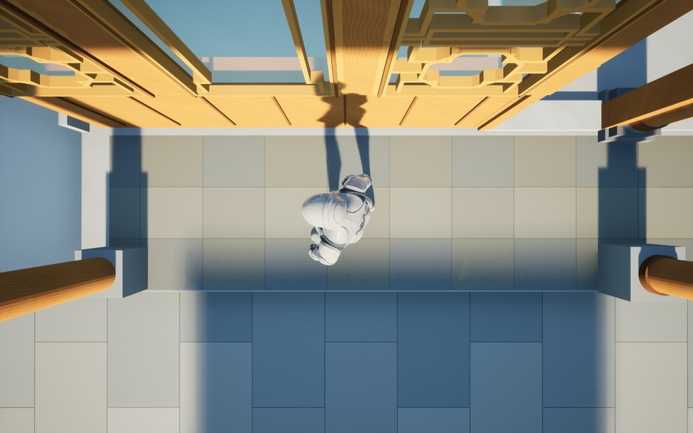](media/smart-home/roam-materials.jpg) 首轮漫游人物与材质 · 原过程截图 | 建立人物漫游与光照入口，修复 49 项材质并重新分配相关构件，保留源属性与 UV 修复记录。 | `Reports/roam_material_upgrade.json`、`Reports/source_attribute_repair.json` |
| 储藏房照片材质 [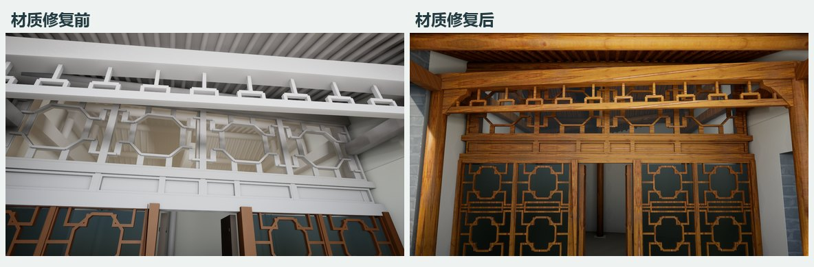](media/smart-home/storage-photo-material.jpg) 储藏房照片材质同机位对照 · 原过程对照 | 实景照片采样用于木构及墙面，调整花窗玻璃；28 个部件有同机位对照。 | `储藏房实景材质优化说明.md`、`Reports/storage_photo_delivery_summary.json` |
| 受控发布  受控重导入核验 · 核验记录图 | 建立可编辑源、稳定构件 ID、暂存预检及材质覆盖恢复。分别归档空更新与隔离重导入核验。 | `ModelSync/模型持续迭代与同步说明.md`、`ModelSync/Reports/no_op_update.json`、`ModelSync/Reports/isolated_ue_reimport_test.json` |
| 漫游视高与移植 [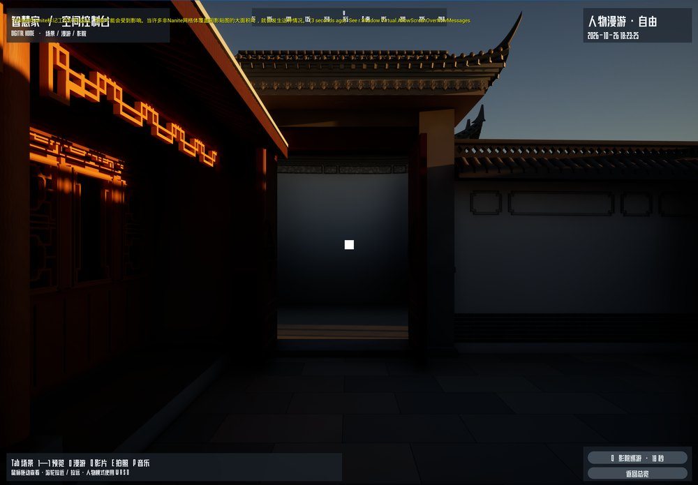](media/smart-home/roam-eye-height.jpg) 第一人称视高校准 · 原过程截图 | 移植编号视角、地理日照与人物操作，在 UE 编辑器/PIE 中核验；第一人称视高校准到 1.65 m。 | `InteractionUpgrade/交互移植与地理日照说明.md`、`InteractionUpgrade/视高165cm_修正记录.md` |

## ModelSync 每轮模型发布

已逐个读取 **22** 个修订目录。21 次保存结果为 PASS，1 次只找到基线和候选。每行通用证据位于 `ModelSync/Revisions/<发布号>/request.json` 与 `result.json`；“计划差异”依次为新增、删除、几何和材质标记数。材质标记含重导入时重新核验和恢复覆盖的项目。部件数取实际保存结果。

| 发布号与配图 | 本轮模型迭代 | 构件 | 计划差异 | 结果与专题过程文件 |
| --- | --- | ---: | --- | --- |
| `20261027_101346_eea6f1bf` [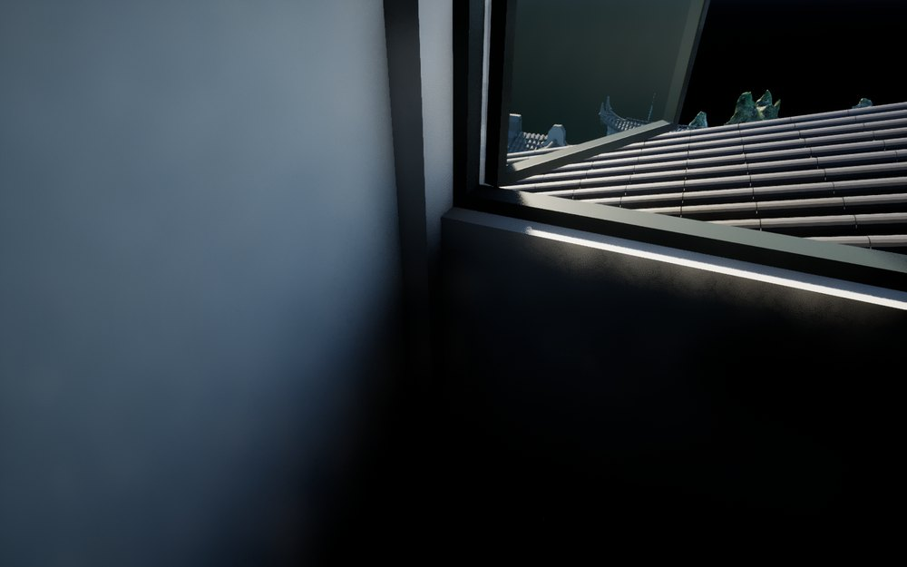](media/smart-home/f3-closures.jpg) 三楼前窗右侧收口 · 原过程截图 | 补齐三楼书房墙顶及前窗右侧窗下转角，核对封口与通行。 | 796 | 2 / 0 / 0 / 794 | PASS · `ModelRepair_F3_20261027/三楼墙体收口修复说明.md` |
| `20261027_162830_edd1b5c0`  外墙修复暂存候选 · 核验记录图 | 外墙修复前段留下的暂存候选。 | — | — | 候选。该目录仅有 `baseline_before.json` 与 `Candidate.3dm`，发布结果待查。 |
| `20261027_163123_9530c28c` [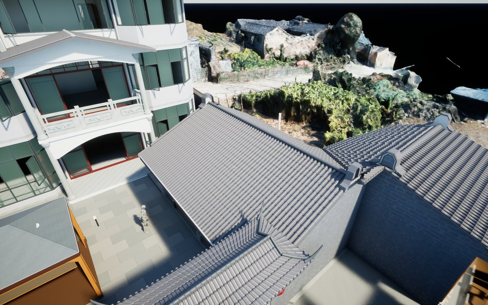](media/smart-home/exterior-repaired.jpg) 首轮修复后的厨房瓦面 · 原过程截图 | 修主楼外墙和厨房北侧瓦带，补东西两端瓦条并检查连接面。 | 799 | 3 / 0 / 2 / 433 | PASS · `ModelRepair_Exterior_20261027/Reports/source_validation.json` |
| `20261027_171211_6a688b58` [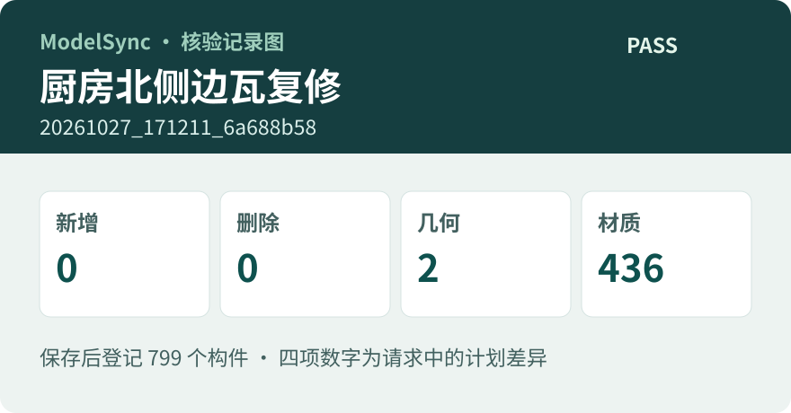](media/smart-home/roof-edge-repair.svg) 厨房北侧边瓦复修 · 核验记录图 | 在外墙修复基础上复修两条北侧厨房屋面边瓦，使边缘接齐。 | 799 | 0 / 0 / 2 / 436 | PASS · `ModelRepair_Exterior_20261027/Reports/roofedge_source_validation.json` |
| `20261027_180252_7f1a8117` [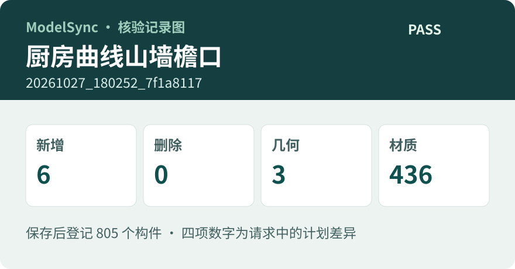](media/smart-home/photo-eaves.svg) 厨房曲线山墙檐口 · 核验记录图 | 按实景参考更新厨房曲线山墙檐口、檐边与收口件。 | 805 | 6 / 0 / 3 / 436 | PASS · `ModelRepair_ReferenceEaves_20261027/Reports/geometry_validation.json` |
| `20261027_205418_6569f3a8` [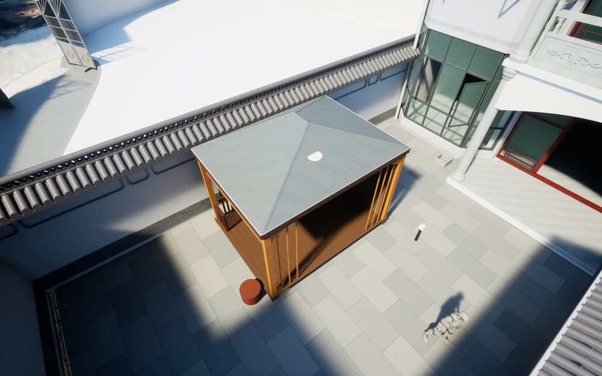](media/smart-home/pavilion-rail-clean.jpg) 亭子扶手与支承校正 · 原过程截图 | 按复核清理七处旧构件，调整亭子扶手、平台支承及相邻构件。 | 798 | 0 / 7 / 23 / 798 | PASS · `ModelRepair_PavilionRail_20261027/Reports/geometry_validation.json` |
| `20261027_220406_52128d92` [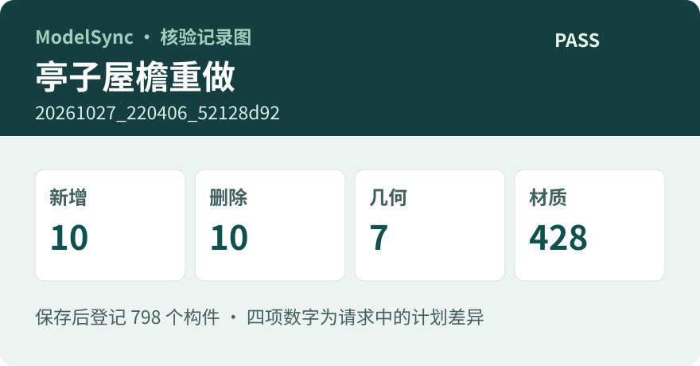](media/smart-home/pavilion-eaves.svg) 亭子屋檐重做 · 核验记录图 | 重做亭子檐口，替换旧瓦与金属边，整理椽子和前部细竖条。 | 798 | 10 / 10 / 7 / 428 | PASS · `ModelRepair_PavilionEaves_20261027/Reports/geometry_validation.json` |
| `20261027_223503_9879fa36` [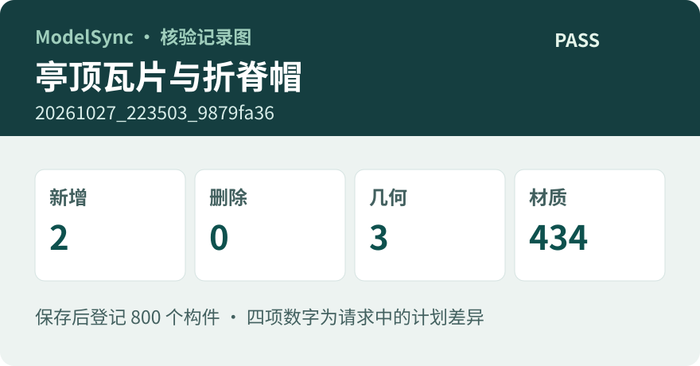](media/smart-home/pavilion-eaves-finish.svg) 亭顶瓦片与折脊帽 · 核验记录图 | 细化亭顶沥青瓦分件与折脊帽，单独核验檐口饰面。 | 800 | 2 / 0 / 3 / 434 | PASS · `ModelRepair_PavilionEaves_20261027/Finish/Reports/geometry_validation.json` |
| `20261027_230406_5e9938cc` [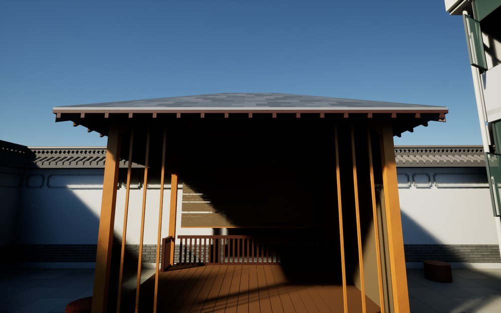](media/smart-home/pavilion-eaves-thin.jpg) 减薄后的亭子檐口 · 原过程截图 | 减薄亭子折边金属与木封檐，保存后复核几何。 | 800 | 0 / 0 / 2 / 434 | PASS · `ModelRepair_PavilionEaves_20261027/Thin/Reports/geometry_validation.json` |
| `20261028_165248_138d8fab` [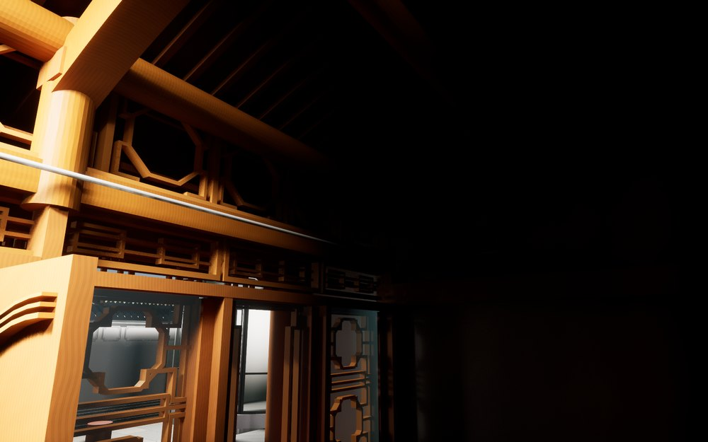](media/smart-home/courtyard-repair.jpg) 修复后的厨房北侧收口 · 原过程截图 | 修院落阶段的厨房上部缺口、储藏房山墙与入口墙段，联动亭子底部。 | 801 | 3 / 2 / 8 / 432 | PASS · `ModelRepair_Courtyard_20261028/Reports/saved_source_validation.json` |
| `20261028_174128_f1276c27` [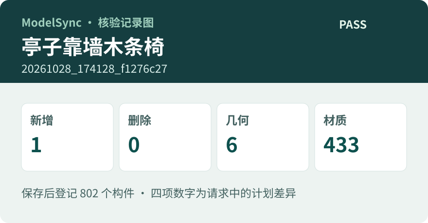](media/smart-home/pavilion-seating.svg) 亭子靠墙木条椅 · 核验记录图 | 亭子加靠墙木条椅，调整平台底部及正面竖条，保留两侧帘。 | 802 | 1 / 0 / 6 / 433 | PASS · `ModelRepair_PavilionSeating_20261028/Reports/saved_source_validation.json` |
| `20261028_175814_41fc0834` [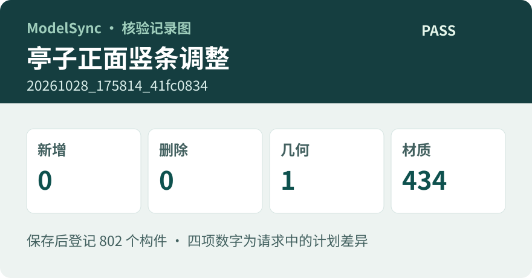](media/smart-home/pavilion-seating-final.svg) 亭子正面竖条调整 · 核验记录图 | 复调亭子正面的细竖条，落实正面通行与保留竖条的要求。 | 802 | 0 / 0 / 1 / 434 | PASS |
| `20261028_181920_49506115` [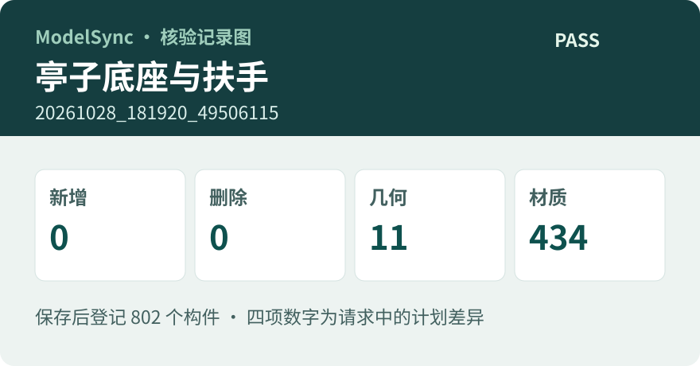](media/smart-home/pavilion-base-rail.svg) 亭子底座与扶手 · 核验记录图 | 调整亭子底座、支脚与扶手几何，核对平台、铺地和扶手的基准面。 | 802 | 0 / 0 / 11 / 434 | PASS · `ModelRepair_PavilionBaseRail_20261028/Reports/saved_source_validation.json` |
| `20261028_195854_0620c442` [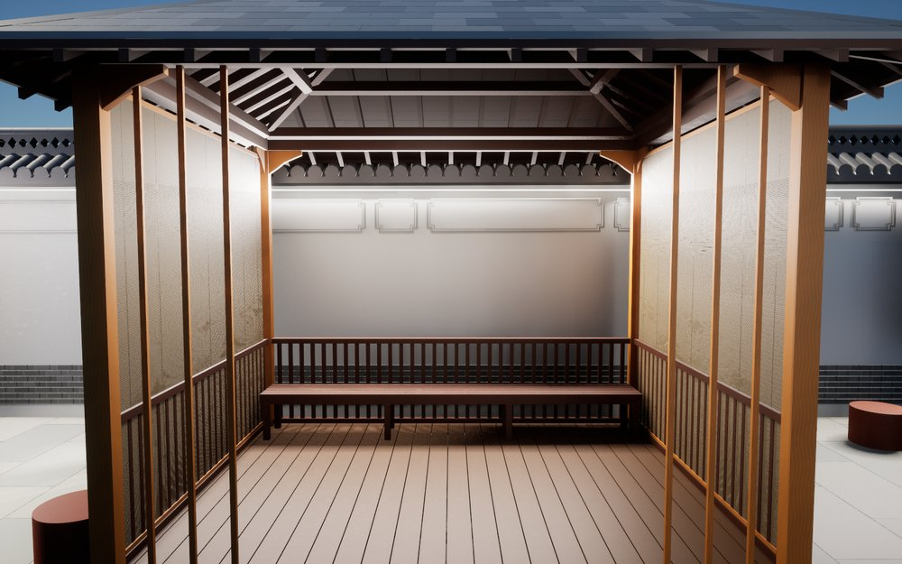](media/smart-home/courtyard-final-review.jpg) 亭台木封边与扶手复核 · 原过程截图 | 亭台定为高出铺地 100 mm、扶手高出平台 900 mm，增 100 mm 木封边。复核厨房补洞、青砖 UV 与双门中柱侧铰链。 | 803 | 1 / 0 / 22 / 434 | PASS · `ModelRepair_FinalReview_20261028/Reports/修复复核.md` |
| `20261029_151004_9090aa90` [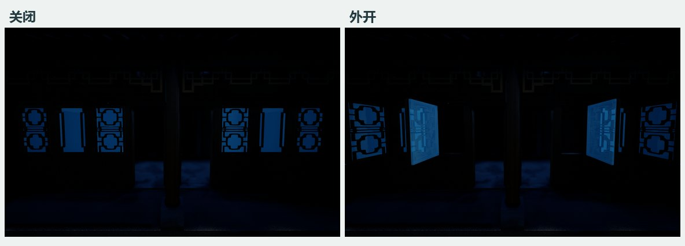](media/smart-home/kitchen-window-sashes.jpg) 厨房四扇窗关闭与外开 · 原过程对照 | 按实景拆分厨房四扇活动窗，补固定件及轴心，核验开合与关闭开口。 | 815 | 12 / 0 / 4 / 434 | PASS · `ModelRepair_KitchenWindows_20261029/使用说明.md` |
| `20261029_161546_f9cef910`  6 mm 玻璃与外开铰轴核验 · 核验记录图 | 把厨房窗玻璃修为 6 mm，保留外侧基准与开合随动。 | 815 | 0 / 0 / 5 / 438 | PASS · `ModelRepair_KitchenWindows_20261029/GlassThin6mm/Reports/saved_source_validation.json` |
| `20261029_193755_baa174db` [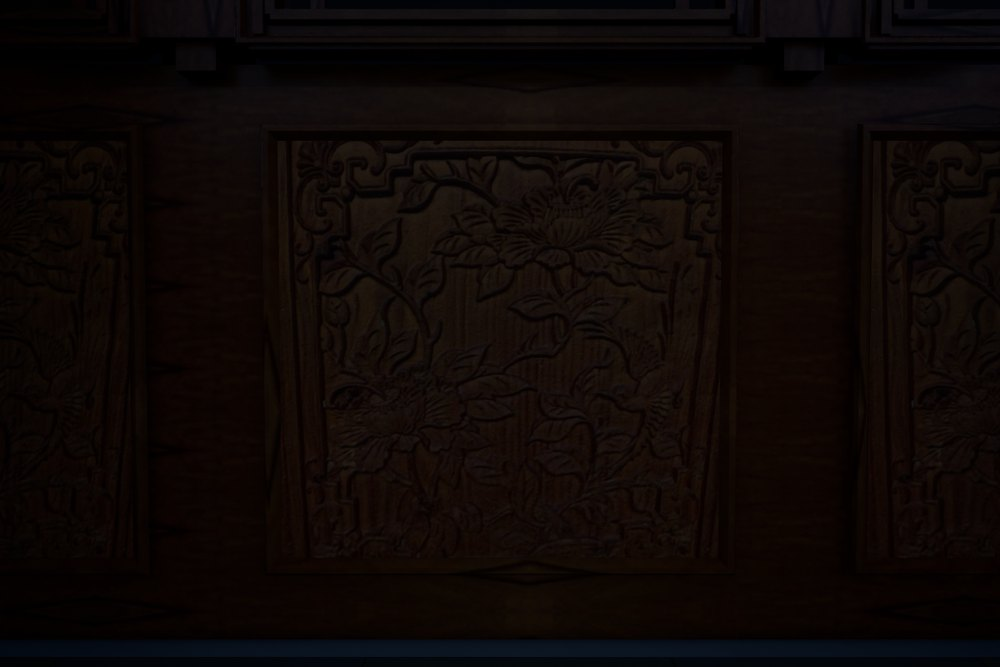](media/smart-home/window-photo.jpg) 三块式下板雕花近景 · 原过程截图 | 首轮按实景修改木窗框、材质及三块式下板，核对关闭开口。 | 819 | 4 / 0 / 18 / 23 | PASS · `ModelRepair_WindowPhoto_20261029/Reports/saved_source_validation.json` |
| `20261029_202728_e9a8f15d` [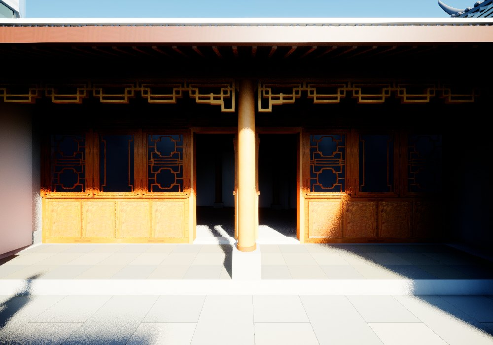](media/smart-home/window-photo-r2.jpg) 四块下板与窄窗台 · 原过程截图 | 改为两组各四块下板，补窄窗台、拉手及插销，调整木框断面。 | 819 | 0 / 0 / 17 / 0 | PASS · `ModelRepair_WindowPhoto_20261029/Revision2_SlimSill4Panels/核验说明.md` |
| `20261029_221502_3273826c` [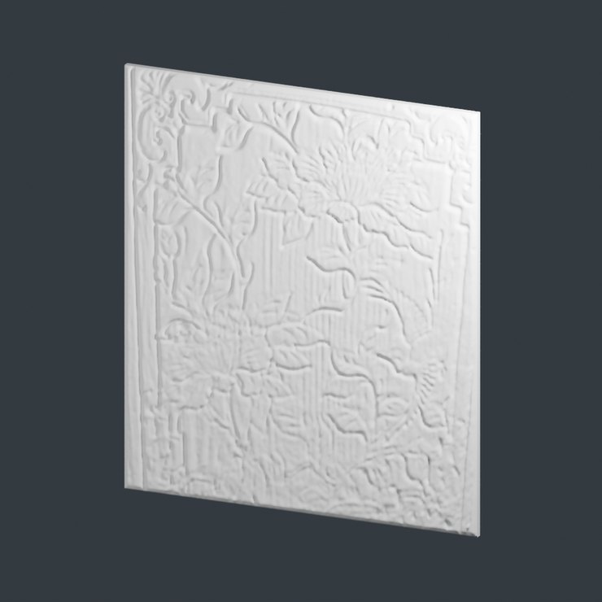](media/smart-home/carved-relief.jpg) 16 位高度图形成的实体浮雕 · 原过程截图 | 把八块下板改为 16 位灰度高度图生成的封闭浮雕，底色用独立木纹。 | 819 | 0 / 0 / 1 / 1 | PASS · `ModelRepair_CarvedRelief_20261029/使用说明.md` |
| `20261029_233622_b2ebe26a` [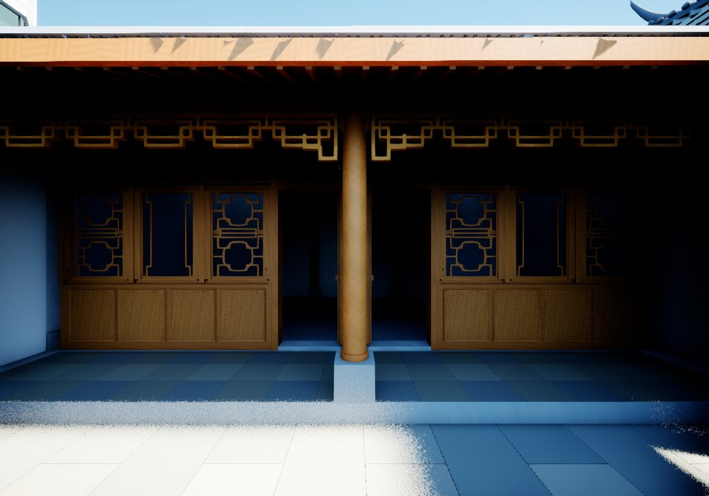](media/smart-home/kitchen-timber.jpg) 统一木纹后的厨房窗 · 原过程截图 | 厨房木构统一为门廊柱的蜂蜜色木纹，保留浮雕几何、玻璃、UV 与铰轴。 | 819 | 0 / 0 / 0 / 33 | PASS · `ModelRepair_KitchenTimber_20261029/使用说明.md` |
| `20261030_013721_b19680b3` [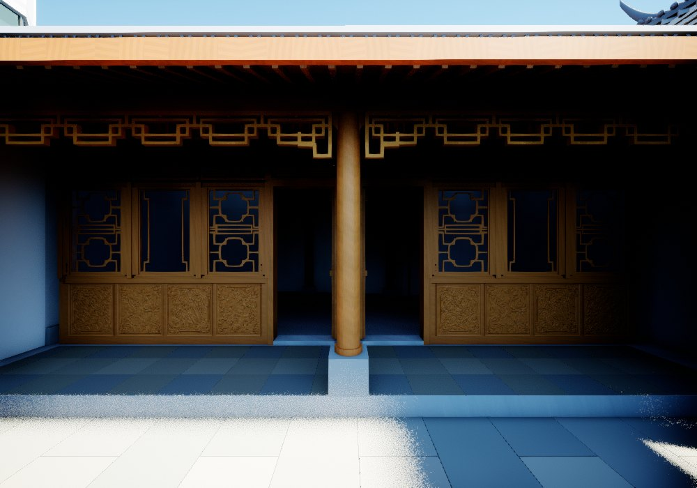](media/smart-home/carving-studio.jpg) 雕花资产回填后的立面 · 原过程截图 | 将四种独立雕花工作台资产回填住宅，使用 256 档网格及细节法线，保留高低档与独立 GLB。 | 819 | 0 / 0 / 2 / 1 | PASS · `ModelRepair_CarvingStudio_20261030/使用说明.md` |
| `20261030_025240_41748228` [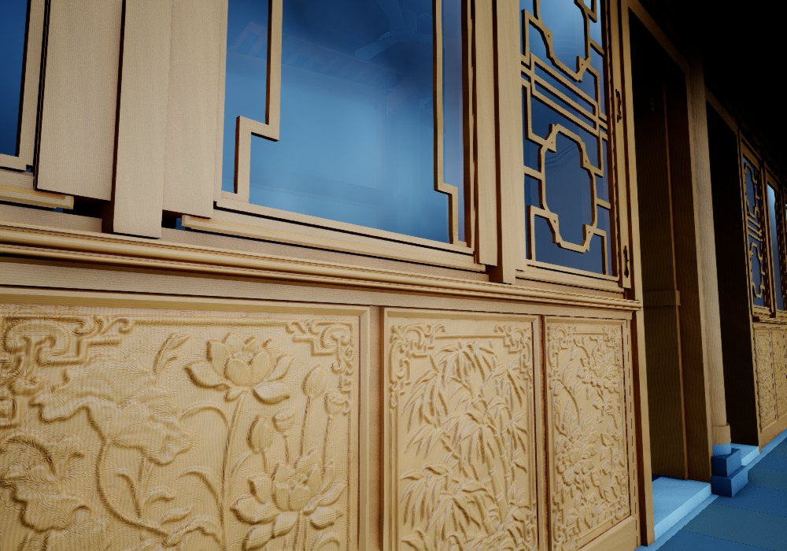](media/smart-home/solid-window-sill.jpg) 实体木窗台剖面 · 原过程截图 | 按固定竖框前表面做 30 mm 外挑窗台，补双圆线脚与封口。独立 Rhino Brep 和 UE 网格均复核。 | 819 | 0 / 0 / 1 / 0 | PASS · `ModelRepair_WindowSillSolid_20261030/使用说明.md` |

## 同一工程的交互、风环境与设备准备

这些改动各有自己的 UE、数据或接口记录，与上表的建筑模型发布号并行登记。

| 过程与配图 | 迭代与核验 | 过程文件 |
| --- | --- | --- |
| 本地软件灯 [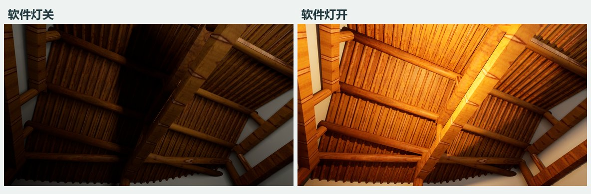](media/smart-home/software-light.jpg) 本地软件灯关与开 · 原过程对照 | 登记灯光、状态与命令，验证软件灯及编辑器联调。原生蓝图节点与打包后运行仍在验收清单中。 | `DigitalTwin_Phase1/Reports/acceptance.json` |
| 夜间照明初版与白灯修订 [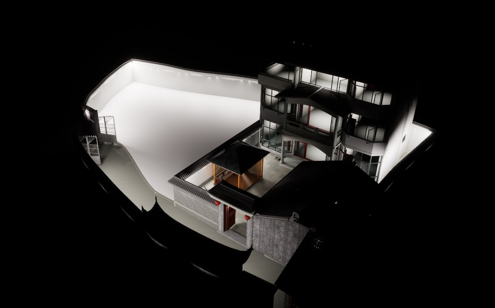](../case-studies/media/reconstruction-to-smart-home/ue-night-lighting.jpg) 白色顶灯和院墙灯带 · 原过程截图 | 按日常夜景布置灯点。后续采用 32 处白色顶灯与院墙灯带，使用 15 个补光源表示五组灯带分区。 | `NightLighting/家庭夜间照明使用说明.md`、`DigitalTwin_Devices/Reports/catalog_summary.json` |
| VSM 与重导入修复 [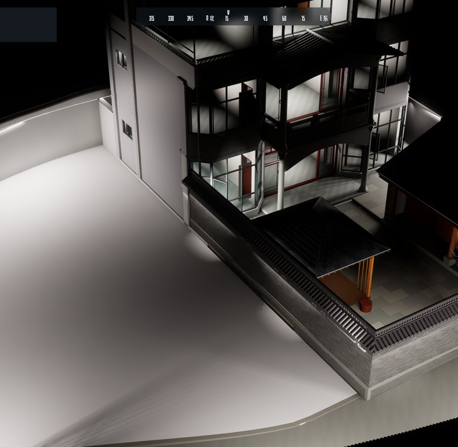](media/smart-home/vsm-review.jpg) VSM 调整后复核 · 原过程截图 | 合并重叠的灯带补光，检查夜间阴影和虚拟阴影贴图日志。重开关卡验证灯具 NoCollision 配置。 | `NightLighting/VSM_Fix_20261028/修复说明.md`、`ModelRepair_FinalReview_20261028/Reports/修复复核.md` |
| 设备目录及入口整理  本地设备目录验收 · 核验记录图 | 本地登记与模拟状态经接口核验，留出门窗、电灯和摄像头绑定。统一入口区分漫游、模型编辑、设备准备和运行检查。实物连接数和配置码流数均为 0。 | `DigitalTwin_Devices/Reports/acceptance.json`、`使用说明.md` |
| 全年日照 [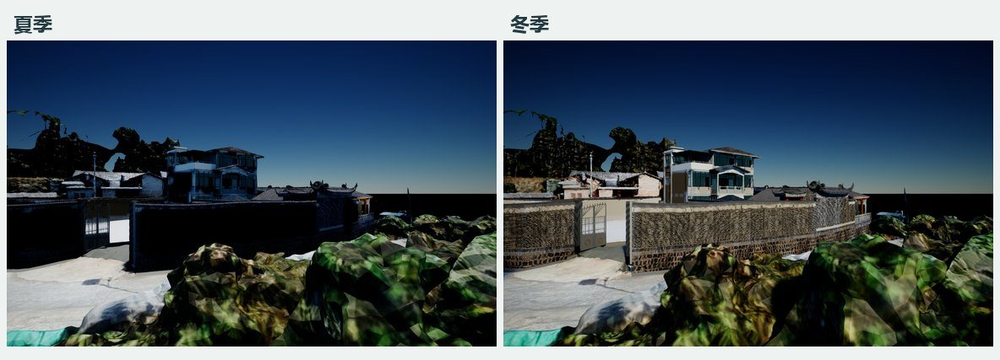](media/smart-home/annual-sun.jpg) 同一时刻的夏季与冬季日照 · 原过程对照 | 地理日照加入全年日期、固定时刻播放与闰年处理，在 UE 中核验太阳方向和输入切换。 | `EnvironmentControls/使用说明.md`、`EnvironmentControls/Reports/completion.json` |
| 风场初版 [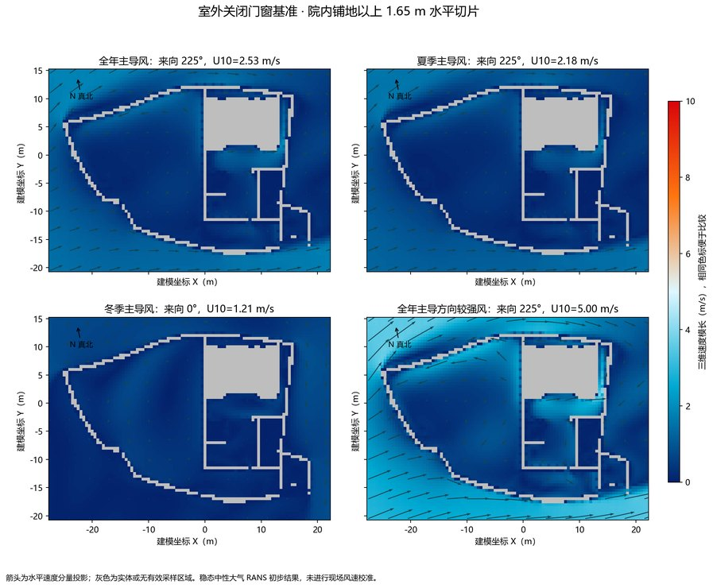](media/smart-home/initial-wind.jpg) 首轮代表风速切片 · 原报告风场图 | 从 EPW 选代表来流，按闭合外形生成网格，以本机 OpenFOAM 求解后导入 UE。细网格对照继续保留待复核。 | `WindAnalysis/使用与核验.md`、`WindAnalysis/Reports/grid_sensitivity.json` |
| 切片与粒子 [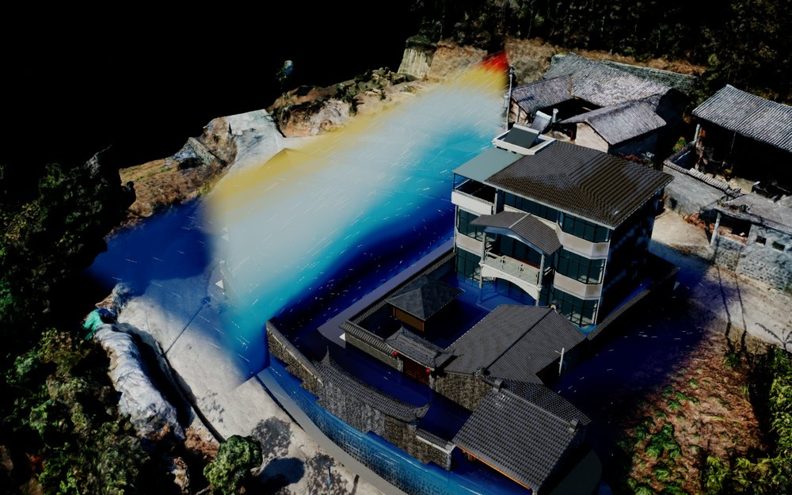](media/smart-home/wind-slices-and-particles.jpg) 原场景切片与粒子轨迹 · 原过程截图 | 增补采样掩码、固定/自动色标、切片迹线、GPU 粒子拖尾和漫游切换。切片风速与播放速度分开。 | `WindAnalysis/SliceRefinement/使用说明.md`、`WindAnalysis/Reports/particle_gpu_bake.json` |
| 竖向与斜向 [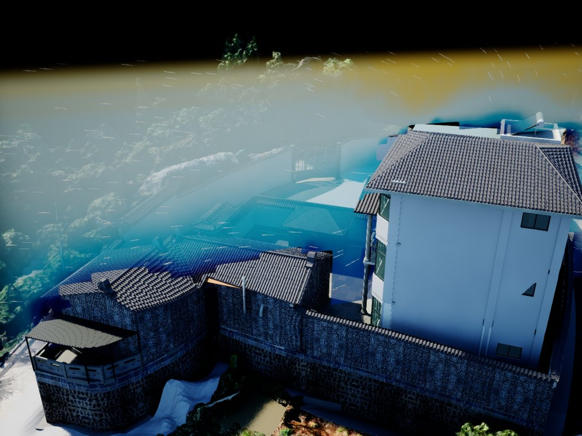](media/smart-home/wind-oblique.jpg) 斜向剖面 · 原过程截图 | 用可移动剖面查看不同位置，调斜切角度，分别核验切片、流线和粒子显示。 | `WindAnalysis/VerticalSlices_20261030/使用说明.md` |
| 厨房开启对照 [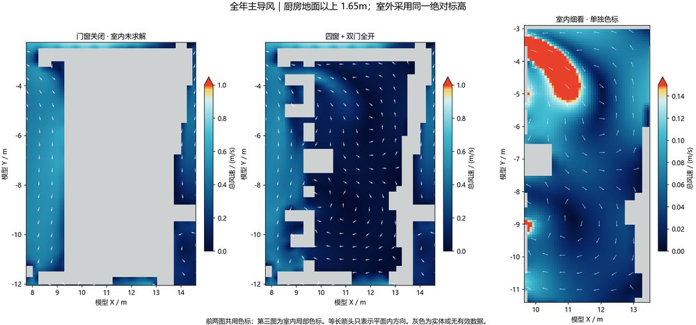](media/smart-home/kitchen-open-wind.jpg) 厨房关闭与开启工况 · 原报告风场图 | 单独求解四窗与双门开启状态，对照关闭状态的代表风、剖面和色标。旧网格映射试算与最终结果分别存档。 | `WindAnalysis/OpeningComparison_20261030/Reports/厨房门窗开启风环境核验.html`、`WindAnalysis/OpeningComparison_20261030/Reports/native_validation.json` |
| 全场地门窗全开 [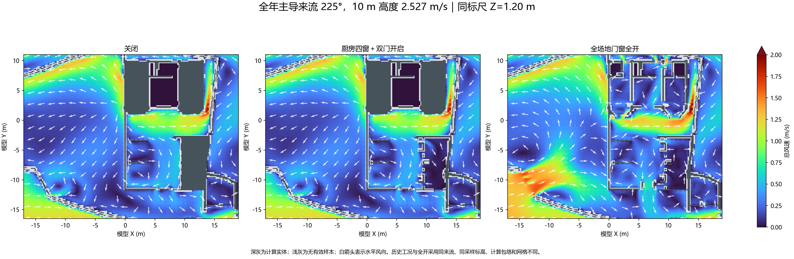](../case-studies/media/reconstruction-to-smart-home/cfd-opening-comparison.png) 三种门窗工况同标尺 · 原报告风场图 | 19 组门、19 组窗，52 个活动段按最大开启姿态。四个代表工况求解和 UE 导入核验通过，网格扩展检查仍为 REVIEW。 | `WindAnalysis/AllOpen_20261109/Reports/delivery_validation.json` |
| 三向切片面板 [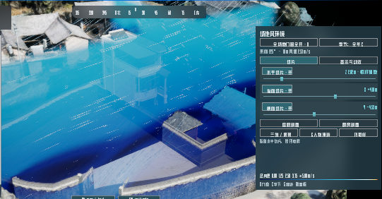](../case-studies/media/reconstruction-to-smart-home/ue-three-slice-panel.png) 三向切片位置控制 · 原过程截图 | 水平 Z、纵向 X、横向 Y 独立控制。隔离 PIE 核验通过，主工程蓝图已安装并与候选 SHA-256 一致。 | `WindAnalysis/Reports/three_slice_panel_validation.json`、`WindAnalysis/Updates/WindDisplay/installed.json` |

EPW 代表风、场景渲染、软件灯反馈和未来的现场观测分别登记。日照用于预览太阳方向与阴影。风场用于稳态 CFD 的工况交互，现场校准与网格独立性仍待核验。设备层当前是本地模拟和登记准备。

## 编号场景与开场漫游

三次记录按本地核验日期排列，沿用场景发布号 **20261030_025240_41748228**。表中的机位误差和画面亮度来自隔离的 UE 5.8 Play In Editor（PIE）核验。亮度使用 8 位显示值。

| 日期与配图 | 迭代与核验 | 过程文件 |
| --- | --- | --- |
| 2026-11-09 · 五个参考机位与影片 [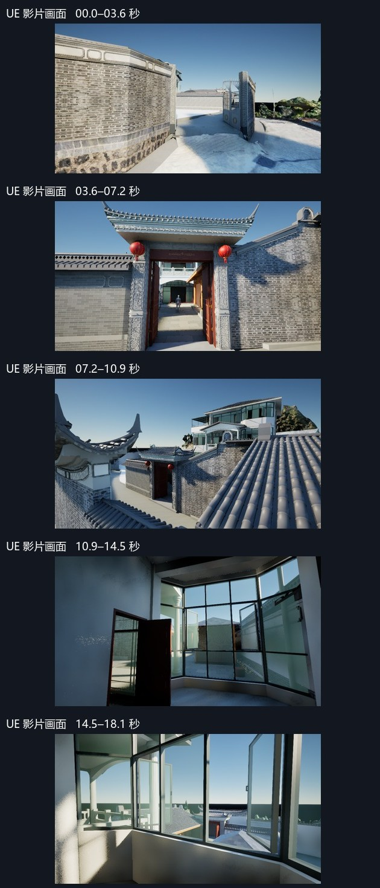](media/smart-home/reference-views-sequence.jpg) [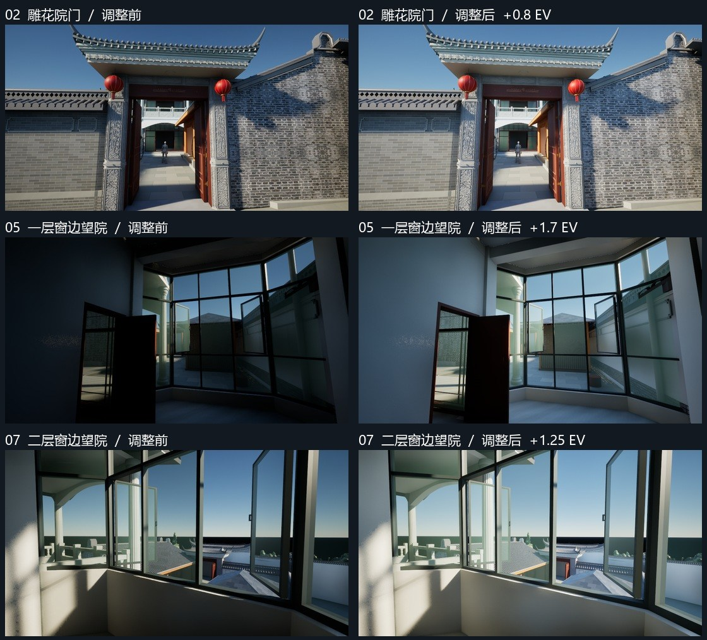](media/smart-home/reference-views-exposure.jpg) 五个镜头与三组曝光对照 · UE 视口截图 | **已保存 · 隔离 PIE 通过。** 按 04 外铁门、02 雕花院门、03 瓦檐、05 一层窗边、07 二层窗边设置 Q 巡游。影片 543 帧、30 帧/秒、18.1 秒。02、05、07 分别增加 0.8、1.7、1.25 EV，暗部取样区中位亮度分别为 28.43→57.60、20.66→80.77、37.43→90.07。该批画面的近白像素占比为 0%，951 个静态网格 Actor 的指纹相同。 | `InteractionUpgrade/ReferenceViews/video-spec.md`、`InteractionUpgrade/ReferenceViews/verification.json`、`InteractionUpgrade/ReferenceViews/installation.json` |
| 2026-11-10 · 场景切换与控制台 [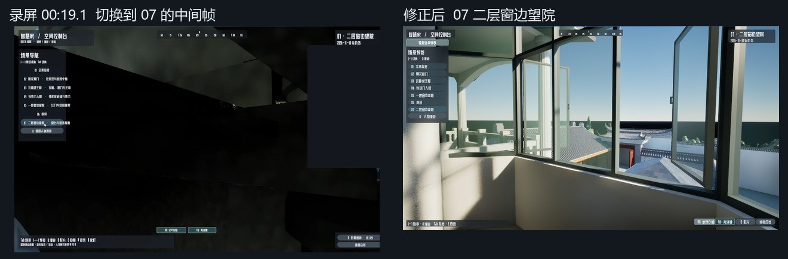](media/smart-home/console-review-cut.jpg) [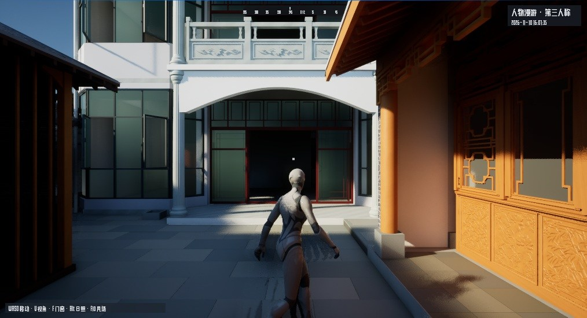](media/smart-home/console-review-roam.jpg) 07 切换前后与人物漫游 · UE 视口截图 | **隔离 PIE 通过。** 点击 1–7 后首个采样 tick 的机位位置误差均为 0 cm，键盘 6、7 在第 2 个采样 tick 到位。日期面板默认收起，日期、曝光、夜景分别打开。核验了人物漫游菜单开关、影片隐藏控制台、退出风场恢复预览与返回总览。 | `InteractionUpgrade/ConsoleReview_20261110/verification.json` |
| 2026-11-10 · 03 开场与临时视角 [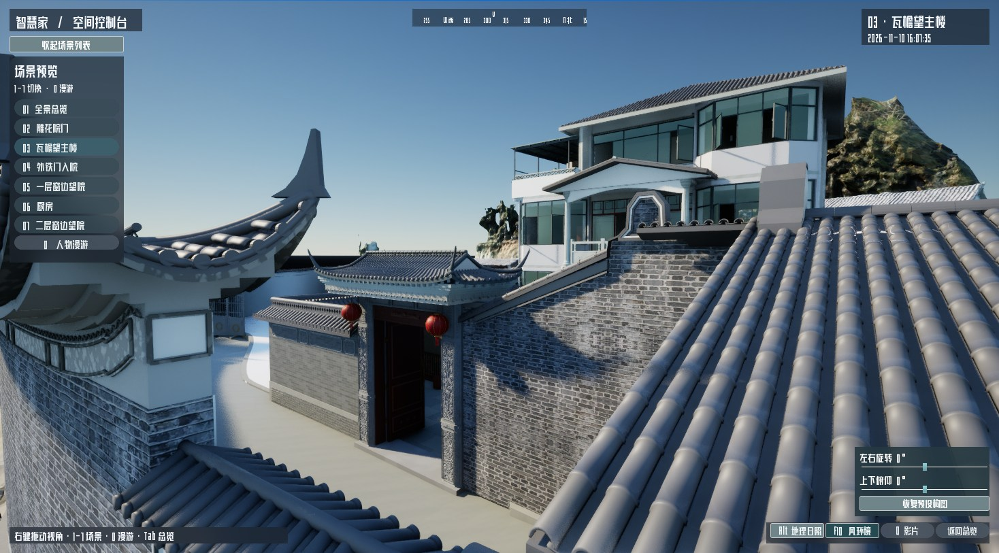](media/smart-home/start-view-03.jpg) [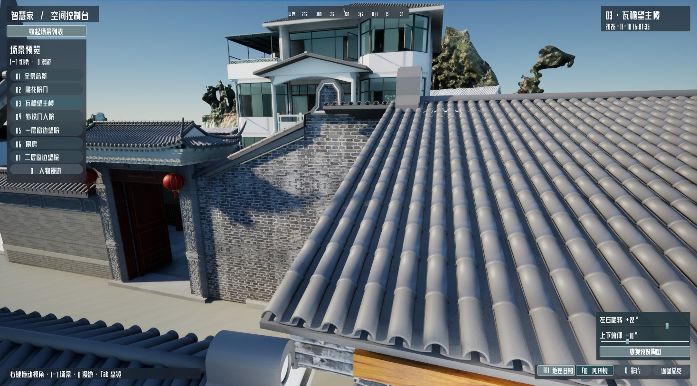](media/smart-home/start-view-03-adjusted.jpg) 默认开场与角度调整 · UE 视口截图 | **项目脚本及核心资产校验一致 · 隔离 PIE 通过。** Play 开场为 03 瓦檐望主楼，首个采样帧位置误差 0 cm。右键或滑块调整临时角度，恢复预设后姿态与基线一致。0 进入漫游，V 切换第一／第三人称。稳定漫游显示 WASD，按 6 回厨房首个采样帧已到位并隐藏提示，Tab 返回环绕总览。 | `InteractionUpgrade/StartView_20261110/核验与操作.md`、`InteractionUpgrade/StartView_20261110/verification.json` |

[相机、曝光与交互核验的实现](research/smart-home.md#编号场景与开场漫游) · [截图出处](media/README.md#智慧家记录)

[看 UE5 漫游与风场图](../case-studies/reconstruction-to-smart-home.zh-CN.md#3-智慧家场景) · [风场与重导入实战](../case-studies/ue5-building-twin.zh-CN.md) · [日常更新记录](updates.md)
