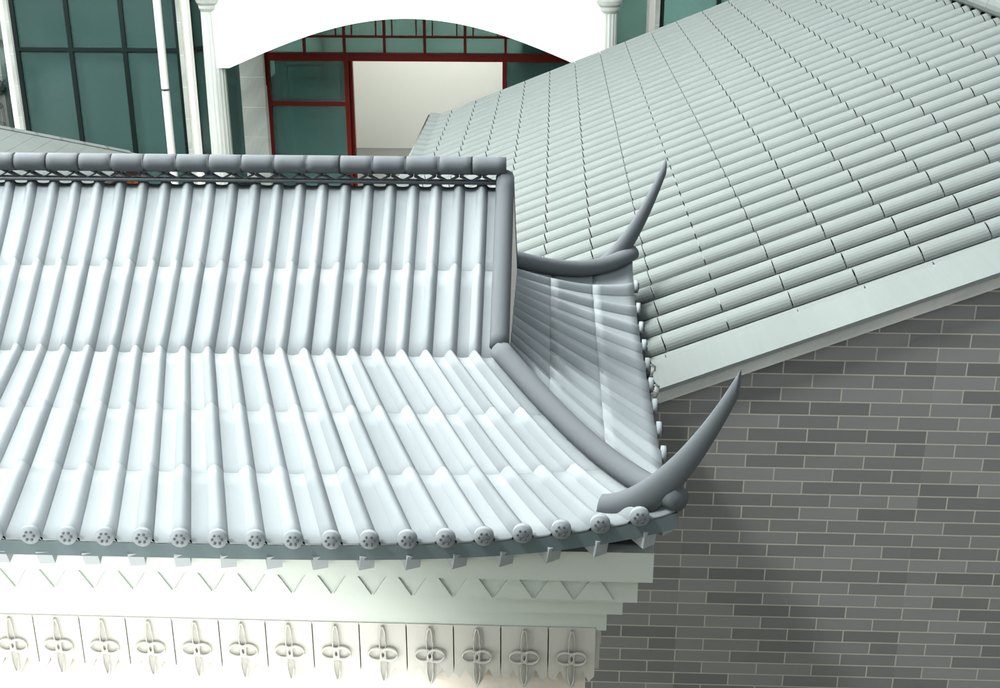
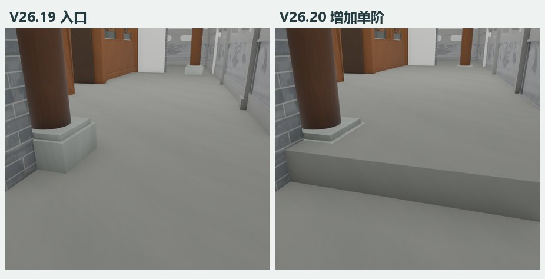
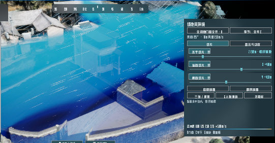

# 日常更新

按实际过程记录续写，最新一轮放在最上面。家庭数字孪生的建模、UE 场景、环境分析与设备准备统一记在仓库 `main`。

## 2026-11-11 · 实现链、完整过程与专业解释

- 在 82 版文章中补充 555 个源码阅读入口，定位实际调用、文件引用与公开行号，区分阅读顺序和有证据的执行结果。 [逐版文章](research/versions/README.md)
- 每版新增完整过程索引：归属 3,543 次图像引用，涉及 2,345 幅不同原图；交付与历史记录位置共 4,178 个。其余 735 幅现有专题或未单版归属图仍列全图档。 [覆盖与来源](research/process-coverage.md)
- 补写坐标与法线、面积加权拟合、剖切定位、布尔保护域、照片和程序材质、配准误差、门窗与漫游、跨软件交接及 CFD 动画的技术解释；保留失败、候选和后续修订。 [方法原理](research/methodology.md)
- 只读复算 V23 旋转块、正射像素尺度及 V26.20 名义挤出量与体积净增量的区别；主交付记录未变化，本轮没有登记新模型或新软件验收。 [数值与字段](research/numerical-review.json)

## 2026-11-10 · 补齐逐版研究实现

- 给 82 版文章附上 2,272 个原脚本与启动文件，包括实际改模、核验、漫游、测量和性能模块；原路径与双 SHA-256 按版登记。31 项含站点坐标的公开副本标明脱敏位置并阻断直接执行，其余 2,241 项保留原字节。V24.02 补齐真正入口及调用模块。 [逐版源码](research/source-code/README.md)
- 按本次提供的五张 UE5 原始截图重排项目首页，建立主图、入口和室内视角、迭代入口与实现流程。截图逐字节保留并附出处。 [项目首页](../../README.md)
- 补入五段已保存过程动画：V24.17 环绕、V24.18 外开窗、V26.8 楼梯斜视、旧室外基准风场和五机位巡游；提供完整 MP4 与 GIF 预览，区分模型复核、动作和软件模拟。 [动画与来源](research/animations/README.md)

- 优化 82 篇版本文章的阅读排版，前后对照图按宽度换行，核验读数纵向排列，出处与校验值按需展开，目录增加阶段跳转。 [版本文章目录](research/versions/README.md)
- 将建筑重建台账的 82 个版本逐版写成技术文章，给出输入、实现、核验和过程图出处。各篇共引用 172 张过程图。 [版本文章目录](research/versions/README.md)
- 核验场景控制台的 1–7 按钮切换、日期／曝光／夜景面板与人物漫游。随后把 03 瓦檐望主楼设为 Play 开场，复测临时偏角、恢复预设和漫游提示。两轮均有隔离 PIE 记录。[控制台和开场核验](smart-home.md#编号场景与开场漫游)

- 按 82 个建筑版本和 39 条智慧家记录补齐研究输入、实现步骤、脚本、原报告和图源。 [逐版研究实现](research/README.md)
- 用原始 CC 三角面样本和 V23 坐标矩阵复算凉亭图，复核筛出的 2,215 点与原 ROI 一致，发布的 PNG 与附件一致。 [凉亭复算和验收](research/pavilion.md)
- 补入原始高度、空洞、正射匹配及保存网格剖面等单张图，按写图脚本与图号回查。 [研究图来源](research/figure-sources.md)

## 2026-11-10 · 补录 Codex 的定位、材质和软件操作

- 补记 V7 用户圈画、V24.22 纵向与水平剖面、V24.36 道路坐标网格，以及从诊断到读回核验的步骤。 [定位与剖切](codex-methods.md#从圈画定位到模型坐标)
- 按原报告串起实景取样、照片贴图、灰度浮雕、Blender 局部编辑、Rhino 原生读回及 UE5 重导入。 [Codex 改模方法](codex-methods.md)
- 按工序归档用户标注、诊断图、材质图、工具视图和验收图。每张图可按编号回查版本或历史对话中的出处。 [过程图档与索引](process/README.md)

## 2026-11-09 · 建立家庭数字孪生总台账

- 整理首版到 V26.20 的 82 条建筑重建记录，注明 V24.02 归档与 V26 的来源底稿。[建筑重建台账](reconstruction.md)
- 根据采集者补记，标明 Insta360 全景相机用于地面细节视频，DJI Mini 2 无人机用于地理信息和屋顶鸟瞰照片。[采集资料与建模基线](reconstruction.md#源资料与建模基线)
- 补记原设计图纸、ContextCapture 航拍实景和地面资料各自的用途，记录从 V5 室内校正到 V6 空地配准的过程。[空地融合建模](reconstruction.md#空地融合建模)
- 补记大门等不清晰结构的处理流程，包括实景参考、GPT Image 整体与分解图、倾斜摄影模型量取与 AI 测算，以及整理为 Codex 改模指令。[结构参考与尺寸来源](reconstruction.md#结构参考与尺寸来源)
- 从 Rhino/Datasmith 首次导入接到 22 个 ModelSync 目录，分开记录 21 次保存通过和 1 个候选。另登记门窗、日照、风场与软件设备准备的本地验收。[智慧家台账](smart-home.md)
- 记录全开风场与三向切片的已核验范围。主工程安装的切片蓝图与隔离 PIE 候选文件校验一致。[风环境与三向切片](../case-studies/reconstruction-to-smart-home.zh-CN.md#4-风环境与三向切片)
- 给 82 个重建版本、5 条资料来源和 39 条智慧家记录逐项配图，补齐原图与核验记录的出处。[台账配图出处](media/README.md)
- 核验五个参考机位、Q 巡游的 543 帧镜头顺序，以及 02、05、07 的曝光对照。已保存关卡、序列和界面包。[参考机位与曝光对照](smart-home.md#编号场景与开场漫游)

| 门楼与厨房交接 | 储藏房入口台阶 | UE5 三向切片 |
| --- | --- | --- |
|  |  |  |

## 每次更新怎么记

1. **从原工程找变更**。读取当轮交付说明、ModelSync 请求与结果、保存后核验或分析报告。按原编号区分新版本、同版补记、候选和备份。
2. **记录差异与证据**。写实际发生日期、前后版本、对象、单位和依据、结果及局限。新增的现场测量、照片估算、建模目标、模拟和物理反馈分别标明。研究图补记原输入、坐标变换、采样阈值、出图脚本、用到的模型版本和核验结果，按迭代加入研究实现表。
3. **准备公开内容**。向相应版本台账增加一行，补本页日期条目并附图。过程图按问题标注、坐标或剖切、材质取样与映射、软件操作、保存后结果补进图档，注明模型或发布号、单位、坐标基准和原文件。只有过程报告时可按记录数据制作核验图，并标明类型。原始场地信息、生产模型、完整日志和设备连接配置在本地管理。
4. **核对后更新主分支**。检查相对链接、图源、报告与摘要一致性。读取最新远端 `main`，以其为父提交，使用快进更新。若远端已前进，先按最新内容整合再提交。没有新证据时以已有台账为准。

每轮较复杂的交付可沿用已有核验模板。 [发布与核验模板](../templates/building-twin-release.zh-CN.md)
