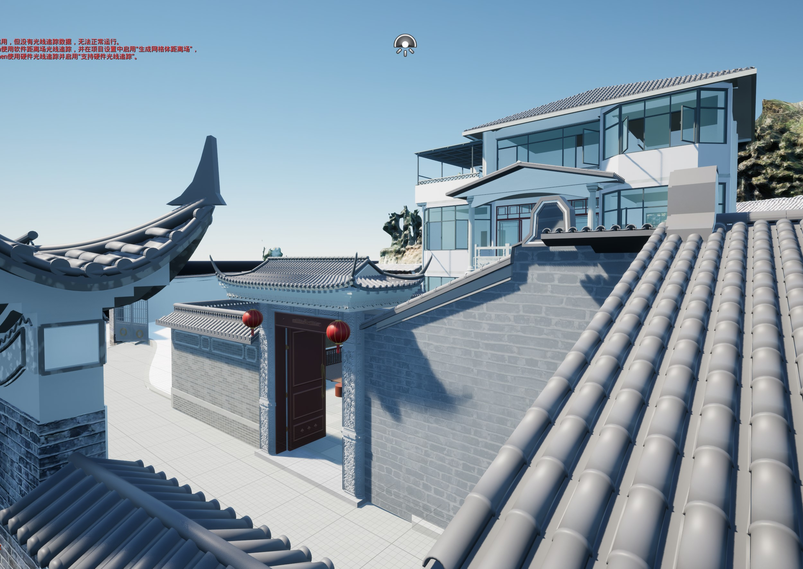
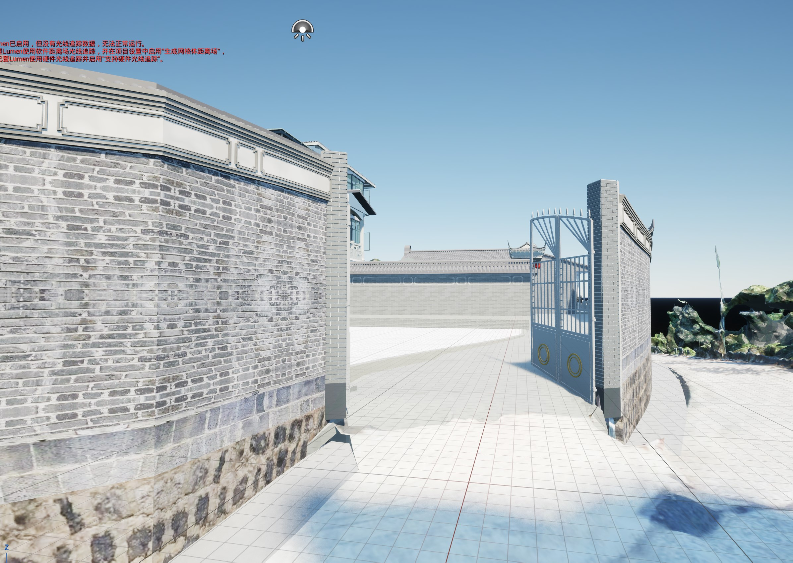
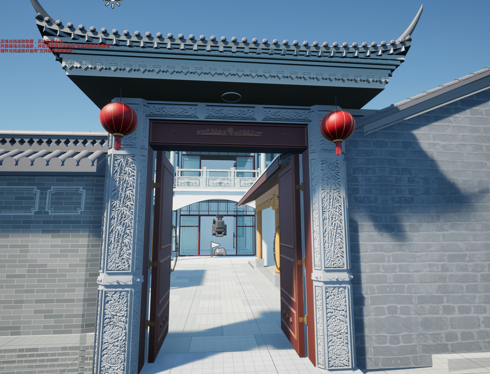
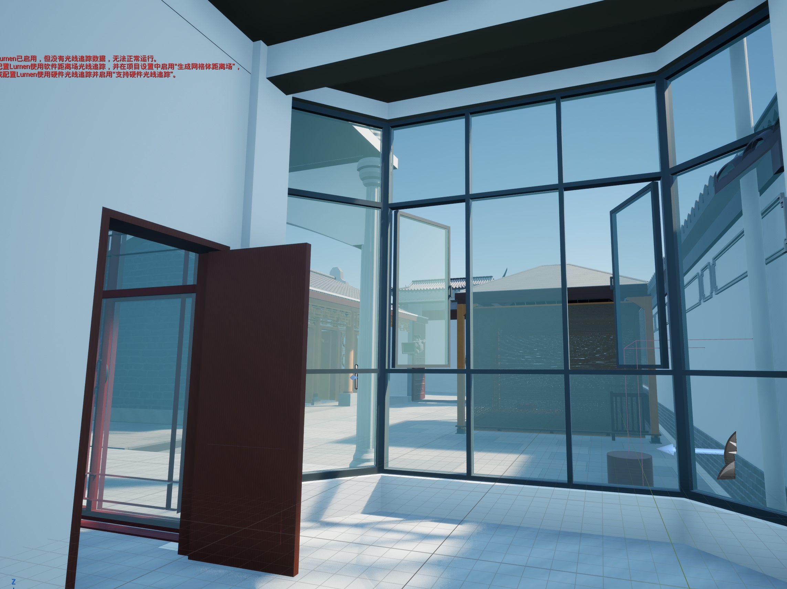
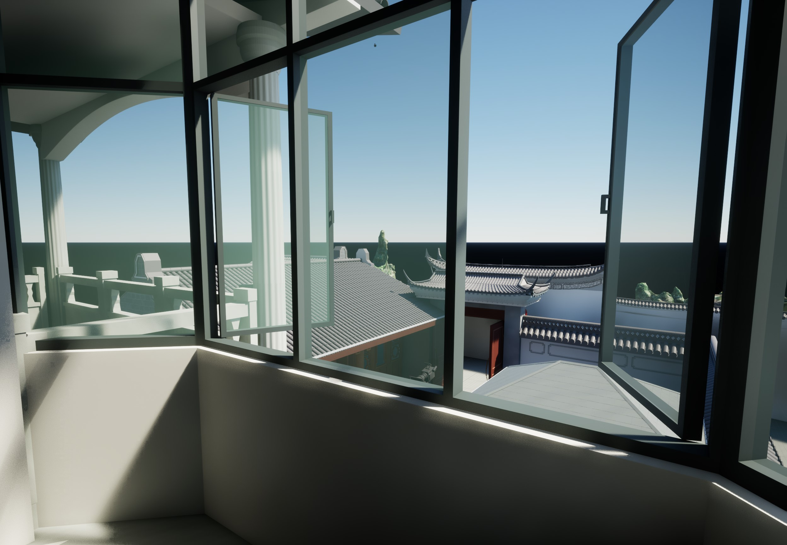

# 项目介绍配图出处

五张图片均为用户于 2026-11-10 指定用于项目介绍的 UE5 场景截图。无重绘、补画或裁剪，公开文件与附件逐字节一致。原画面中的编辑器警告、光源与相机图标予以保留；这些是软件预览，不代表实物验收。`11.jpg` 只作为首页排版参考，不加入场景图集。

[逐图文件与 SHA-256](manifest.json)

**瓦檐望主楼**

**外围铁门入口**

**雕花门楼正面**

**一层室内望庭院**

**二层窗边望庭院**

